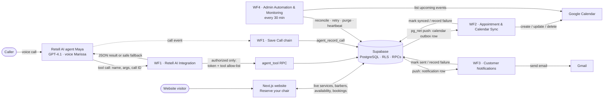

# Project Architecture — Blade & Crown

Architecture derived **only** from the demonstration video. Components or connections not visible on screen are excluded or marked **"Not confirmed from video."**

## System Overview

Blade & Crown is built around one principle visible throughout the demo: **Supabase is the single source of truth.** The website, the voice agent, the calendar, and email are all views or side-effects of the database — never independent copies.

| Component | Role | Evidence |
|---|---|---|
| Next.js website | Customer-facing booking ("Reserve your chair"), services/barbers loaded live from Supabase | Title card "Next.js website"; narration: "Every service, price, barber and photo is loaded live from Supabase" |
| Retell AI agent "Maya" | Voice receptionist (GPT-4.1, voice "Marissa"); books, moves, cancels by voice 24/7 | Call panel header; site banner |
| n8n (4 workflows) | Secure tool gateway, calendar sync, email notifications, monitoring | Workflow sections 1–4 |
| Supabase | Database, availability engine, RPC layer (`agent_tool()`, `agent_record_call`), outbox pushes via pg_net, RLS | Sticky notes; "Supabase + RLS" end card |
| Google Calendar | Salon calendar mirror of confirmed appointments | Workflows 2 & 4 |
| Gmail | Customer email delivery (confirmations, changes, cancellations, reminders) | Workflow 3 Gmail node + sticky note |

## Integration Overview

| Integration | Direction | Mechanism (as shown) | Auth (as shown) |
|---|---|---|---|
| Retell AI → n8n (Workflow 1) | Inbound tool calls + call events | Webhook POSTs (`/webhook/blade-crown-retell-tool`, `/webhook/blade-crown-retell-events` — paths partially legible on a canvas sticky note) | Secret token in the request + allow-listed tool names |
| n8n → Supabase | Tool execution, claims, status write-backs | HTTP Request nodes calling Supabase endpoints/RPCs | **Not confirmed from video** (credentials never shown) |
| Supabase → n8n (Workflows 2 & 3) | Outbox pushes on booking/notification changes | pg_net HTTP push the moment a row is written | Shared secret (checked by "From Supabase?" IF nodes) |
| n8n → Google Calendar | Create / update / delete / list events | Google Calendar nodes | **Not confirmed from video** (credential screen never shown) |
| n8n → Gmail | Send customer email | Gmail node ("Email Customer") | Gmail credential connected on the node (per sticky note) |
| Website → Supabase | Live services, barbers, availability, bookings | Direct from the Next.js site (mechanism **Not confirmed from video**) | Supabase RLS (per end card) |

## Data Flow

### 1. Voice booking (synchronous, during the call)

```
Caller → Maya (Retell AI) → n8n WF1 webhook → token + allow-list check
       → Supabase agent_tool() RPC → JSON result → Maya speaks it
```

- Availability is **computed in Supabase** from schedules, breaks, holidays, and existing bookings (on-screen claim), so voice and web can never offer different slots.
- Booking is **two-phase**: `create_appointment(confirmed=false)` returns a read-back; only `confirmed=true` writes the appointment. This is the "verification, confirmation" behaviour named on Workflow 1's step list.
- A failed backend call returns a **safe fallback** to Maya rather than an error, keeping the conversation alive.

### 2. Calendar sync (asynchronous, outbox pattern)

```
Booking change → Supabase outbox row → pg_net push → n8n WF2
  → shared-secret check → idempotent Claim → Switch(create|update|delete)
  → Google Calendar → Mark Synced (event ID stored on the appointment)
  └─ on error → Record Failure (exponential back-off, retried by WF4)
```

### 3. Customer notifications (asynchronous, outbox pattern)

```
Notification row → Supabase push → n8n WF3 → Claim → build subject + HTML email
  → Gmail send → Mark Sent └─ on error → Record Send Failure (retry later)
Hourly: WF3 schedule chain queues 24-hour reminders for tomorrow's bookings.
```

### 4. Monitoring & reconciliation (every 30 minutes)

```
n8n WF4 schedule → load calendar setting → list upcoming Google events
  → collect event IDs → reconcile vs Supabase bookings:
      re-create missing events · re-dispatch due retries · unstick stuck jobs
      · purge expired voice transcripts · write health heartbeat
  └─ if Google is unreachable → retry without the check + log a calendar health warning
```

### 5. Call logging

```
Retell call event → n8n WF1 (Chain B) → token check → agent_record_call RPC
  → call metadata + transcript stored for the admin dashboard
  → expired transcripts purged by WF4 (website notice: recordings deleted after 30 days)
```

## Architecture Diagram (Mermaid)



## Design Patterns Visible in the Video

1. **Single source of truth** — availability and bookings live only in Supabase; the calendar is a mirror, the website a view.
2. **Transactional outbox** — side-effects (calendar, email) are rows in Supabase, pushed to n8n; nothing is fire-and-forget from the request path.
3. **Idempotent claiming** — both sync workflows "claim" a queued row before acting, de-duplicating create vs. update and making pushes safe to repeat.
4. **Fail-soft voice gateway** — authentication + allow-list in front of the database, and a safe fallback response on backend error so a live call never hard-fails.
5. **Confirmation before commitment** — the agent must read a booking back and receive explicit confirmation before anything is written.
6. **Self-healing operations** — retries with exponential back-off plus a 30-minute reconciliation sweep and a health heartbeat for the admin dashboard.
7. **Data-retention automation** — call recordings/transcripts are deleted after 30 days (website notice), enforced by the monitoring workflow's purge step.

## Not Confirmed From Video

- The Supabase table schema and the internal SQL of `agent_tool()` / `agent_record_call` (function names are legible on a canvas sticky note; their code is never shown).
- How the website authenticates users (a "Sign in / Create account" step is shown; the auth provider is **Not confirmed from video** — Supabase Auth is plausible but never stated).
- Whether availability also subtracts Google Calendar events, or is computed purely inside Supabase.
- Any payment collection for the stated 50% late-cancellation fee.
- Hosting/deployment details for the website, n8n, or Supabase project.
