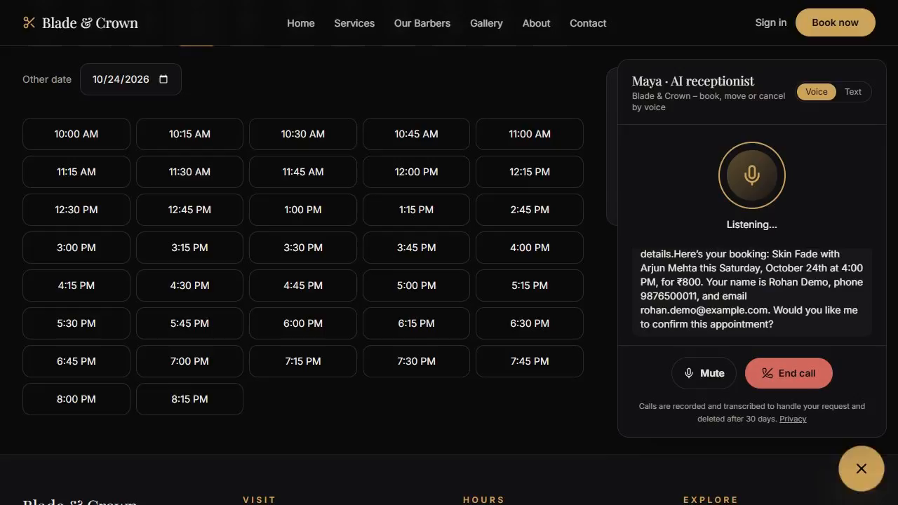
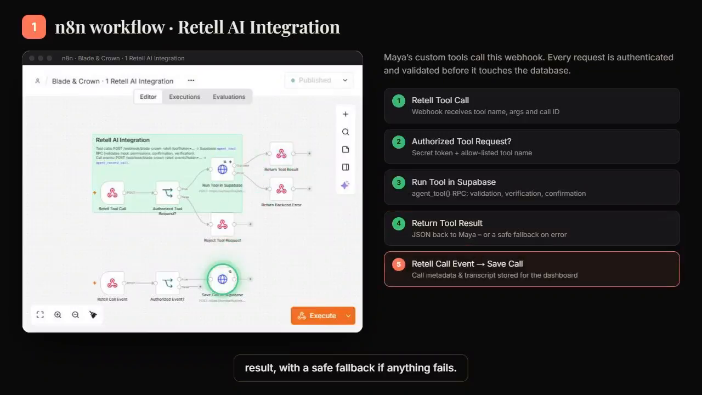
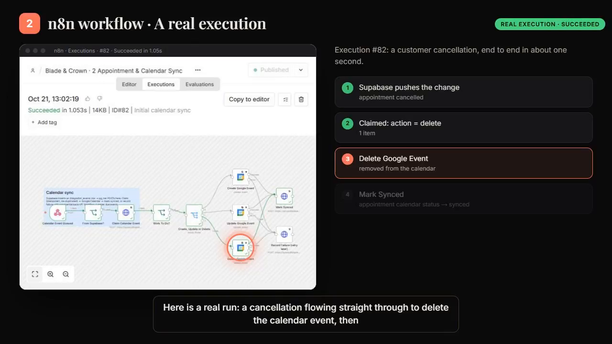

# Blade & Crown — AI Voice Receptionist & Booking Automation

**An end-to-end barbershop platform: a live booking website, a Retell AI voice receptionist ("Maya"), and four n8n workflows that keep Supabase, Google Calendar, and customer email in sync — automatically, around the clock.**



> 📹 **Demo video:** [Watch on LinkedIn](https://lnkd.in/p/dGDK8zmm) — also in [`demo/VIDEO-LINK.md`](demo/VIDEO-LINK.md) with timestamped highlights.
>
> ⚠️ This repository is a **documentation portfolio** built from the project's demonstration video. The original n8n workflow JSON exports are not included — see [`PROJECT-LIMITATIONS.md`](PROJECT-LIMITATIONS.md) for full disclosure.

---

## Overview

Blade & Crown is a barbershop with two ways to book: a website ("Reserve your chair") and a phone/voice receptionist. Both channels run on **one booking engine** backed by Supabase, so a slot booked by voice disappears from the website instantly, and vice versa.

The voice receptionist, **Maya**, is a Retell AI agent (GPT-4.1, voice "Marissa" — as labelled on screen in the demo). Callers can **book, move, or cancel** appointments by voice, 24/7. Maya never touches the database directly: every action goes through secured n8n webhooks that authenticate the request, run it in Supabase, and return a structured result she can speak back.

Behind the scenes, four published n8n workflows handle:

1. **Retell AI Integration** — authenticated tool calls + call-event logging
2. **Appointment & Calendar Sync** — Supabase ↔ Google Calendar, with idempotent claims and retries
3. **Customer Notifications** — confirmation / reschedule / cancellation emails + 24-hour reminders (Gmail)
4. **Admin Automation & Monitoring** — a 30-minute reconciliation and health "safety net"

## The Business Problem

Barbershops lose bookings when the phone isn't answered, and create chaos when web bookings, phone bookings, and the shop calendar disagree:

- Missed calls after hours = lost revenue.
- Double bookings when availability isn't calculated from real schedules, breaks, and holidays.
- Stale calendar events after cancellations or reschedules.
- Customers who forget appointments (no-shows) without confirmations and reminders.
- No audit trail of what the receptionist promised a caller.

## The Solution

A single source of truth (Supabase) with every channel and side-effect automated around it:

- **Live availability** on the website, calculated from barber schedules, breaks, holidays, and existing bookings (on-screen claim in the demo).
- **Maya, the AI receptionist**, checks real availability by voice, reads the booking back, and only books after the caller confirms (a two-phase `create_appointment` flow: `confirmed: false` → read-back → `confirmed: true`).
- **Outbox-style sync:** every booking change writes a row in Supabase, which pushes it to n8n (pg_net, shared secret); n8n claims it idempotently and creates/updates/deletes the Google Calendar event.
- **Automatic emails** for confirmations, changes, cancellations, and a reminder 24 hours before the appointment.
- **A monitoring workflow** reconciles the calendar against bookings every 30 minutes, retries failures with back-off, purges expired call transcripts, and writes a health heartbeat for the admin dashboard.

## Key Features (as demonstrated in the video)

- ✅ Voice booking end-to-end: availability lookup → details → read-back → confirmed booking with a spoken booking code
- ✅ Live tool-call panel showing real requests: `get_available_slots`, `create_appointment` (needs-confirmation, then booked)
- ✅ Authenticated tool gateway: secret token + allow-listed tool names before any request reaches the database
- ✅ Safe fallbacks: backend errors return a safe fallback response to Maya instead of failing the call
- ✅ Call logging: call metadata and transcript stored in Supabase for the admin dashboard
- ✅ Idempotent calendar sync: "Claim" pattern de-duplicates create vs. update; failures recorded with exponential back-off and retried later
- ✅ Real execution shown: a customer cancellation synced to Google Calendar in ~1.05 s (execution #82)
- ✅ Self-healing: 30-minute reconciliation re-creates missing calendar events and logs a calendar health warning if Google Calendar is unreachable
- ✅ Privacy by design (per on-screen text): calls are recorded/transcribed to handle the request and deleted after 30 days; expired transcripts are purged by the monitoring workflow

## Technologies Used

| Layer | Technology | Evidence in video |
|---|---|---|
| Website | Next.js (labelled on the title card) | Title card: "Next.js website" |
| Database / backend | Supabase (PostgreSQL, RLS, pg_net, RPC functions) | "Supabase + RLS" end card; sticky notes name `agent_tool()` and `agent_record_call` |
| Voice AI | Retell AI agent "Maya" — GPT-4.1, voice "Marissa" | Call panel header: `Retell AI · GPT-4.1 · voice "Marissa"` |
| Automation | n8n — 4 published workflows | Workflow sections 1–4 |
| Calendar | Google Calendar | Workflow 2 & 4 nodes ("salon calendar") |
| Email | Gmail (n8n Gmail node, "Email Customer") | Workflow 3 canvas + sticky note |
| Payments | — | **Not confirmed from video** (no payment step is shown) |

## Workflow Architecture

```
Caller ──voice──▶ Retell AI "Maya" ──tool call──▶ [WF1] Retell AI Integration
                                                        │ secret token + tool allow-list
                                                        ▼
                                                   Supabase (agent_tool RPC)
                                                        │
        ┌───────────────────────┬───────────────────────┼────────────────────────┐
        ▼                       ▼                       ▼                        ▼
  Booking rows           Calendar outbox rows    Notification rows        Call records
        │                       │                       │                   (dashboard)
        │                [WF2] Calendar Sync     [WF3] Notifications
        │                       │                       │
        │                       ▼                       ▼
        │                Google Calendar            Gmail email
        │
  [WF4] Admin Automation & Monitoring — every 30 min: reconcile calendar vs bookings,
        retry failures, purge expired transcripts, write health heartbeat
```

Full detail: [`PROJECT-ARCHITECTURE.md`](PROJECT-ARCHITECTURE.md) · Node-by-node: [`WORKFLOW-EXPLANATION.md`](WORKFLOW-EXPLANATION.md)

## How It Works — Step by Step (voice booking)

1. The caller asks Maya for a service and time ("a skin fade on Saturday around four").
2. Maya calls the `get_available_slots` tool → n8n webhook (Workflow 1) → Supabase returns real open times and available barbers (demo: 37 open times; 16:00 available with all four barbers).
3. Maya offers a slot, collects name, mobile, and email.
4. Maya calls `create_appointment` with `confirmed: false`; the backend returns a **read-back** and books nothing yet.
5. Maya reads the booking back (service, barber, date/time, price); the caller confirms.
6. Maya calls `create_appointment` with `confirmed: true`; the appointment is booked and Maya speaks the booking code; a confirmation email follows (Workflow 3).
7. The booking change is pushed to Workflow 2, which creates the Google Calendar event and marks the appointment synced.
8. After the call, Workflow 1's second chain stores the call metadata and transcript for the dashboard.

## Screenshots

| Screenshot | What it shows |
|---|---|
|  | Workflow 1 — Retell AI Integration canvas with its five explained steps (video ~01:31) |
|  | Workflow 2 — real execution #82, "SUCCEEDED", a cancellation synced in ~1 s (video ~01:52) |
|  | Live booking page slot grid with Maya mid-call (video ~00:18) |

## Demo

- 🎬 Video: [Watch on LinkedIn](https://lnkd.in/p/dGDK8zmm) (also linked in [`demo/VIDEO-LINK.md`](demo/VIDEO-LINK.md)).
- The demo states: *"Caller lines are scripted for the demo; every tool call and result is a real request to the production n8n webhook and database."*

## Setup (summary)

Recreating this system requires: an n8n instance, a Supabase project (tables + `agent_tool` / `agent_record_call` RPCs + pg_net pushes), a Retell AI agent with custom tools pointed at the n8n webhooks, a Google Calendar connection, and a Gmail credential in n8n. Full step-by-step, with **verified-from-video** details separated from suggested reconstruction: [`SETUP-GUIDE.md`](SETUP-GUIDE.md).

## Use Cases

- Barbershops, salons, and clinics that miss after-hours calls
- Any appointment business needing web + voice booking on one availability engine
- Shops that need calendar accuracy enforced automatically (cancellations/reschedules)
- Owners who want an auditable log of every AI-handled call

## Limitations

- This repo documents the system **from the demo video only**; no workflow JSON, source code, or live link is included.
- Some internal configuration (exact RPC logic, table schema, prompt text) is not visible in the video and is marked "Not confirmed from video" in the docs.
- See [`PROJECT-LIMITATIONS.md`](PROJECT-LIMITATIONS.md).

## Future Improvements

*(Suggested by the documentation author — not shown in the video.)*

- Publish sanitized n8n workflow JSON exports for one-click import
- Add SMS/WhatsApp confirmations alongside email
- Deposit/no-show fee handling for late cancellations (the website already states a 50% late-cancellation policy; payment collection is **not confirmed from video**)
- Multi-branch support with per-branch calendars

## Author

**Fahad Ahmed Shanawar** — Agentic AI Architect | AI Agents • n8n • RAG • Voice AI

- GitHub: https://github.com/AiwithFahad
- LinkedIn: https://www.linkedin.com/in/fahad-ahmed-shanawar-107a5535a/
